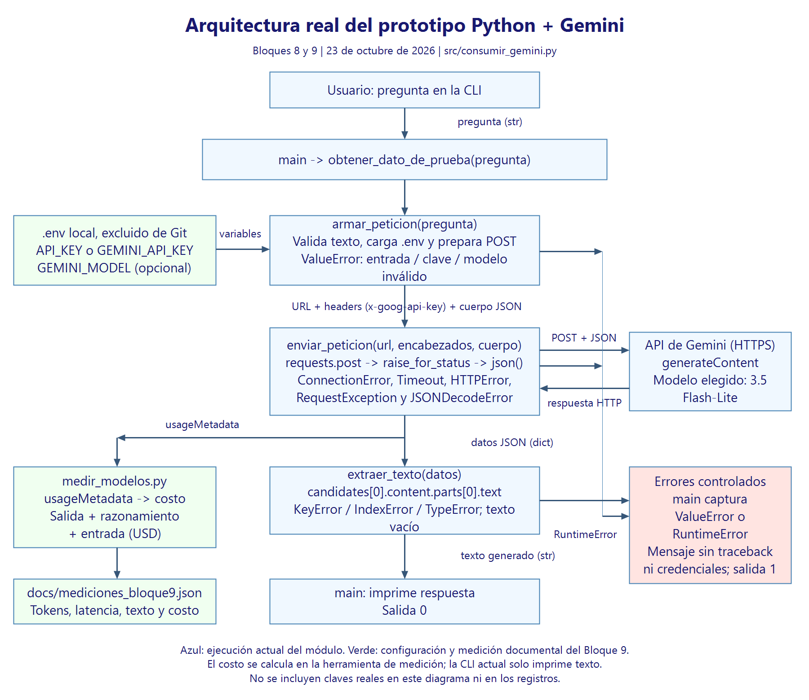

# Arquitectura del prototipo Python

Fecha: 2026-10-23. Este diagrama se incorpora como prerrequisito documental del
Bloque 9; representa el código actual, no una implementación de bloques futuros.



El usuario entrega una pregunta a `main`, que llama a
`obtener_dato_de_prueba`. El orquestador ejecuta en orden:

1. `armar_peticion`: valida el texto, carga `.env` desde la raíz y construye la
   URL, los encabezados y el cuerpo JSON. La clave local se llama `API_KEY`;
   también admite `GEMINI_API_KEY`, con prioridad. El valor se coloca en
   `x-goog-api-key`. Una entrada inválida genera `ValueError` antes de usar red.
2. `enviar_peticion`: realiza el POST HTTPS, comprueba HTTP y convierte a JSON.
   Captura `ConnectionError`, `Timeout`, `HTTPError`, `RequestException` y
   `JSONDecodeError`; los convierte en `RuntimeError` con mensajes legibles.
3. `extraer_texto`: obtiene `candidates[0].content.parts[0].text`; maneja
   `KeyError`, `IndexError`, `TypeError` y texto vacío o de tipo incorrecto.

`main` recibe el texto y lo imprime; ante `ValueError` o `RuntimeError`, imprime
el mensaje controlado y devuelve código 1. El camino correcto devuelve 0.
El módulo no implementa interfaz web, persistencia, RAG ni streaming.

El costo se calcula en la herramienta documental
[`medir_modelos.py`](medir_modelos.py), después de recibir el JSON y su
`usageMetadata`. Se registra junto a los tokens y latencias en
[`mediciones_bloque9.json`](mediciones_bloque9.json).
La CLI actual imprime únicamente el texto: el diagrama distingue esa ejecución
del cálculo usado para comparar modelos, sin atribuirle funciones inexistentes.

La fórmula a tarifa Standard de pago, sin caché ni herramientas, es:

```text
costo_USD = (promptTokenCount * precio_entrada_por_millon
             + (candidatesTokenCount + thoughtsTokenCount)
               * precio_salida_por_millon) / 1_000_000
```

Cuando `thoughtsTokenCount` no está presente se usa cero. Si faltan los
contadores de entrada o salida, el script no inventa un costo. Es un equivalente
según tarifas públicas: no verifica si la cuenta está en nivel gratuito ni la
facturación efectiva. Las tarifas de salida incluyen razonamiento.

La [decisión de modelo](decision-arquitectura.md) utiliza esta arquitectura y
las mediciones reales. Las credenciales permanecen fuera de Git y de la evidencia.
