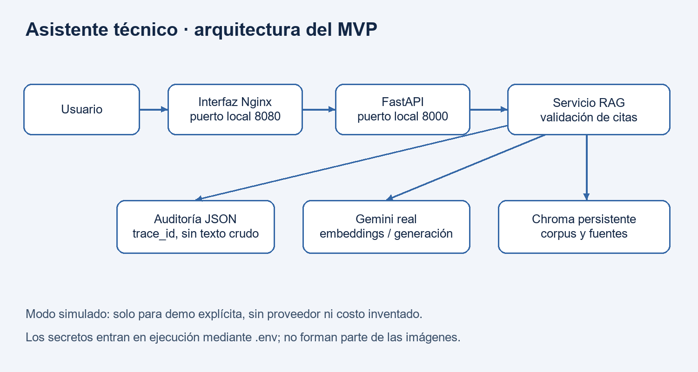
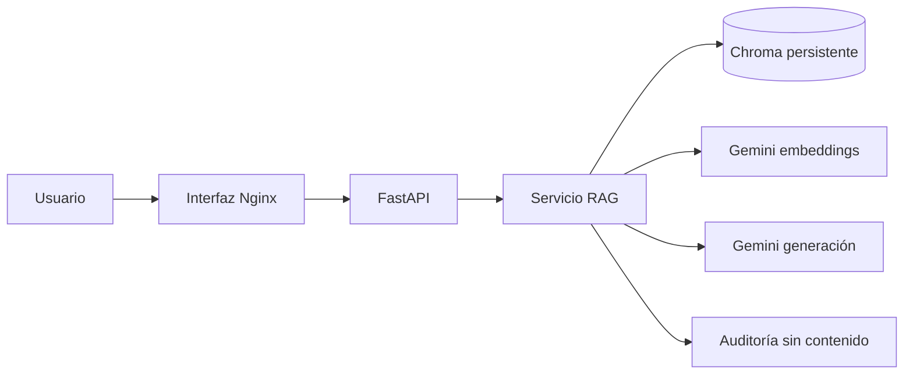

# Ficha de Diseño Funcional

## 1. Problema de negocio
Estudiantes que integran Python con Gemini necesitan localizar procedimientos de su propio proyecto sin confundir consejos generales con decisiones reales del repositorio. Para planificar el MVP se estima una carga de 10 consultas semanales de 5 minutos de búsqueda manual (50 minutos); es una hipótesis, no una medición con usuarios. Se espera obtener respuestas trazables y poder reconocer cuando el corpus no alcanza.

## 2. Requerimientos y alcance (MVP)
### Requerimientos funcionales
- RF-01: responder preguntas sobre el proyecto con fuentes recuperadas.
- RF-02: mostrar respuesta y fuentes en una interfaz web.
- RF-03: consultar un catálogo local de códigos HTTP.
- RF-04: rechazar entradas inválidas e instrucciones de inyección conocidas.
- RF-05: exponer salud, documentación OpenAPI y errores uniformes.
- RF-06: mantener una bitácora técnica sin preguntas ni documentos crudos.
- RF-07: permitir entrenamiento automático de modelos; fuera del MVP por costo y falta de datos.
### Requerimientos no funcionales
- RNF-01: recuperar la fuente relevante en al menos 8 de las 10 preguntas con respuesta del conjunto etiquetado.
- RNF-02: rechazar 100 % de las ocho entradas inválidas de test_api.py sin invocar al proveedor.
- RNF-03: API e interfaz deben arrancar sanas con un único comando Compose.
- RNF-04: ninguna credencial debe quedar en Git, corpus o capas de imagen.
### Alcance
Imprescindible: RF-01, RF-02, RF-03, RF-04, RF-05, RF-06.
Deseable: ninguna ampliación hasta cerrar pruebas y contenedores.
Fuera de alcance: RF-07, cuentas de usuarios, datos personales y ejecución de pagos.

## 3. Arquitectura de la solución

Interfaz HTML/JS → proxy Nginx → FastAPI → ServicioRAG → Chroma + embeddings Gemini → cliente HTTP Gemini → citas y auditoría.

Se conserva Gemini 3.5 Flash Lite para generación con tarifas registradas. Chroma permite reapertura sin reindexar y IDs estables. LangChain se emplea en cadenas/agentes separados e inyectables; el servicio usa funciones explícitas para medir cada etapa. FastAPI valida el contrato y Compose coordina dos servicios locales, sin exponerlos a Internet.

## 4. Criterios de aceptación
| ID | Requisito | Dado / cuando / entonces | Evidencia |
|---|---|---|---|
| CA-01 | RF-01 | Dado el corpus, al consultar HTTP 429 devuelve respuesta con cliente.md y cita válida. | registro_rag.py |
| CA-02 | RF-02 | Dada la interfaz, al enviar la pregunta muestra respuesta y fuentes sin ejecutar HTML del modelo. | prueba de interfaz |
| CA-03 | RF-03 | Al solicitar /errores/429 devuelve el diagnóstico local. | prueba HTTP |
| CA-04 | RF-04 | Al enviar los ocho cuerpos inválidos devuelve 422 sin llamar al servicio. | test_api.py |
| CA-05 | RF-05 | GET /salud devuelve 200 y /openapi.json describe POST /consultas. | prueba HTTP |
| CA-06 | RF-06 | Cada evento de una consulta comparte trace_id y no contiene el texto de entrada. | test_servicio_rag.py |
| CA-07 | RNF-01 | Las 10 preguntas etiquetadas recuperan al menos 8 fuentes relevantes con k=1. | resultados_evaluacion.txt |
| CA-08 | RNF-03 | Compose construye dos contenedores y ambos alcanzan healthy. | verificar_stack.py |

| CA-09 | RNF-02 | Las ocho entradas inválidas definidas devuelven 422 sin invocar al proveedor. | test_api.py |
| CA-10 | RNF-04 | El escaneo de archivos rastreados, corpus e imagen no encuentra credenciales. | buscar_secretos.py, verificar_imagen.py |

## 5. Plan de construcción por hitos
Horas disponibles: 24 h (estimación de planificación del MVP; no horas trabajadas medidas).
Margen de imprevistos: 4 h.
- H1 (3 h): Cliente y datos de evaluación. Cubre: RF-01, RNF-01. Se comprueba con: CA-01, CA-07.
- H2 (4 h): API y catálogo local. Cubre: RF-03, RF-04, RF-05, RNF-02. Se comprueba con: CA-03, CA-04, CA-05, CA-09.
- H3 (3 h): Interfaz web con salida segura. Cubre: RF-02. Se comprueba con: CA-02.
- H4 (4 h): Composición y protección de secretos. Cubre: RNF-03, RNF-04. Se comprueba con: CA-08, CA-10.
- H5 (6 h): Auditoría, QA, documentación y ensayo. Cubre: RF-06. Se comprueba con: CA-06.

Las 20 h planificadas incluyen una reserva de 6 h para pruebas, documentación y defensa, más 4 h de imprevistos fuera de los hitos. Es un presupuesto explícito, sujeto a revisión del alumno; no se atribuye a una validación externa.
