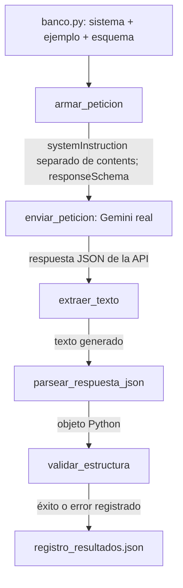

# Banco de prompts — Bloque 10

El banco reutiliza el prototipo de aprendizaje técnico del proyecto. Cada
entrada de [`banco.py`](banco.py) contiene nombre, versión, instrucción de sistema
completa, entrada de usuario de ejemplo, claves esperadas, esquema de tipos y
una salida ilustrativa. Los ejemplos son sintéticos, sin datos personales.

| Prompt | Tarea | Salida exigida |
|---|---|---|
| `clasificar_consulta_tecnica` v1 | Clasificar una consulta sobre HTTP 429 | `categoria`: string de un enum; `confianza`: número entre 0 y 1 |
| `extraer_contexto_tecnico` v1 | Extraer datos explícitos de una incidencia en Python | `tecnologia`: string; `codigo_http`: integer entre 0 y 599; `problema`: string |
| `resumir_explicacion_tecnica` v2 | Resumir el procedimiento de creación de un entorno | `resumen`: string; `pasos`: array de 1 a 3 strings, en orden |

Todos los strings deben contener texto. Las claves deben coincidir exactamente;
no se aceptan claves adicionales. Los booleanos no cuentan como números.

## Cómo se conectan las piezas



`armar_peticion` admite `system_instruction` y `response_schema` opcionales,
manteniendo las llamadas anteriores con una sola pregunta. La clave sigue
leyéndose desde el `.env` local y se envía en el encabezado de autenticación.
La respuesta estructurada se solicita con `generationConfig.responseMimeType`
y `generationConfig.responseSchema` del endpoint REST `generateContent`.

`parsear_respuesta_json` retira un bloque Markdown completo, si existe, y
convierte el texto a un objeto con `json.loads`. Rechaza prosa extra, JSON
cortado, arrays en la raíz y constantes no JSON como `NaN` o `Infinity`.
`validar_estructura`, compartido desde `src/validacion_json.py`, comprueba claves, tipos, enum, intervalos, strings no vacíos
y tamaños e ítems de listas. Implementa el subconjunto usado por este banco;
no pretende validar cualquier esquema JSON Schema externo.

## Ejecutar la prueba real

Desde la raíz del repositorio, con las dependencias y la clave ya configuradas:

```powershell
.\venv\Scripts\python.exe -m prompts.test_consistencia
```

Esto realiza **9 peticiones reales**, tres por prompt, con una pausa de un
segundo entre llamadas. Puede consumir cuota y reemplaza el registro actual.
Para conservar otra medición en un archivo distinto:

```powershell
.\venv\Scripts\python.exe -m prompts.test_consistencia --destino prompts/historial/otra_medicion.json
```

El script no se ejecuta al importarlo. Cada fallo de red, HTTP, extracción,
parseo o estructura queda registrado con su motivo y no detiene los otros
intentos. No se repite una llamada a escondidas ni se descartan fallos.
Devuelve código 0 si todas las respuestas son válidas y 1 si falla alguna.
El campo `fecha_fin` indica que terminó la serie completa; un archivo sin
esa marca representa una ejecución parcial y no una validación finalizada.

## Resultados y ajuste del prompt

La ejecución real del 23 de octubre de 2026, con
`gemini-3.5-flash-lite`, se conserva en
[`registro_resultados.json`](registro_resultados.json). Contiene fechas,
versiones, modelo solicitado y devuelto, tiempo, tokens, texto generado,
objeto interpretado, errores y conteos por prompt. Un hash SHA-256 vincula
el registro con el contenido exacto del banco utilizado.

Resultado de la ejecución final:

| Prompt | Intentos | Válidos | Fallos | Consistencia estructural observada |
|---|---:|---:|---:|---:|
| Clasificar consulta técnica v1 | 3 | 3 | 0 | 100 % |
| Extraer contexto técnico v1 | 3 | 3 | 0 | 100 % |
| Resumir explicación técnica v2 | 3 | 3 | 0 | 100 % |

Total: **9/9 respuestas válidas**. En la revisión de los tres resúmenes v2,
los pasos describen crear, activar e instalar dependencias, sin rutas ni
comandos deformados. La redacción varía, como es esperable en un modelo.

La [primera ejecución](historial/registro_inicial.json), con los tres prompts
en versión 1, pasó 9/9 validaciones estructurales. En la revisión cualitativa,
la tercera respuesta del resumen deformó una ruta de Windows añadiendo
`textbackslash`. Ese defecto de contenido **no se contó como error de JSON**:
el objeto sí respetaba el esquema.

Se ajustó solo el prompt de resumen a versión 2: ahora pide describir acciones
sin reproducir comandos, rutas ni código. El banco original está en el commit
`f8641a2`. Después se ejecutó de nuevo el banco completo y se conservó la nueva
medición, sin borrar la inicial. El cambio corrige el enfoque del resumen;
los comandos ejecutables del proyecto permanecen documentados en el README.

La consistencia medida es **estructural**: que cambie la redacción entre
repeticiones no constituye un fallo. Pasar la validación no demuestra que todo
el contenido sea correcto ni garantiza resistencia a inyección de prompts.
Tres repeticiones son el mínimo del curso, no evidencia de fiabilidad universal.

## Pruebas locales y referencias

```powershell
.\venv\Scripts\python.exe -m unittest discover -s tests -v
```

Las 26 pruebas del banco y del cliente no llaman a Gemini. Cubren compatibilidad con el flujo
anterior, separación de sistema/usuario, limpieza, JSON inválido, tipos,
claves, límites, errores de red y cómputo de éxitos/fallos. Cobertura medida:
99 % sobre `src/` y `prompts/` en la medición del Bloque 10; las líneas sin ejecutar son puntos de entrada.
El Gate 1 agrega seis pruebas de la miniaplicación, para un total de 32.

Referencias: [consigna del Bloque 10](https://learning-pro.skillnest.com/mod/page/view.php?id=20316),
[API REST generateContent](https://ai.google.dev/api/generate-content) y
[salida estructurada de generateContent](https://ai.google.dev/gemini-api/docs/generate-content/structured-output).
